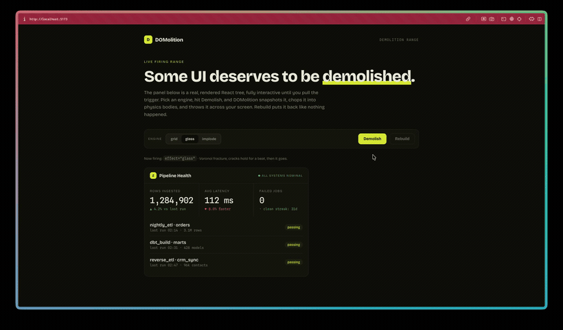
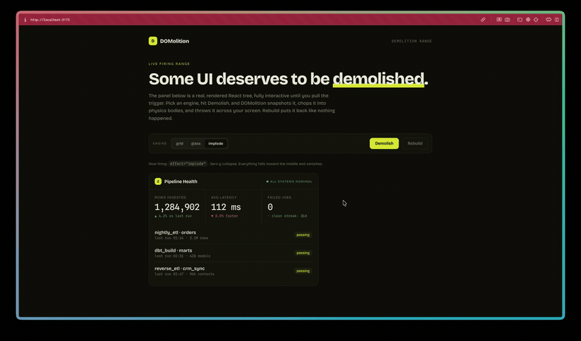
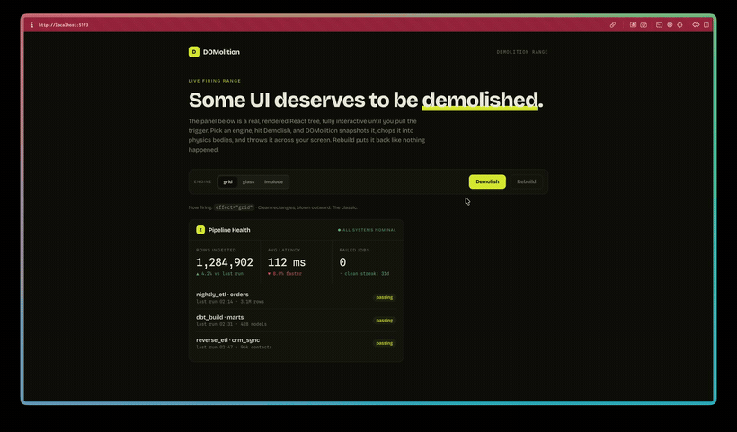

# DOMolition

> *"Because sometimes the only valid response to centering a div is blowing up the entire UI."*

Blow up any piece of UI. DOMolition snapshots a DOM element, hides the real one, and destroys the picture on a full-screen canvas: shattered glass, a controlled demolition, a katana slice, a melt, a Thanos-style disintegrate, and more. It ships as a React component **and** as one plain-JS function that works anywhere.

**[▶ Try it live](https://zakiaminn.github.io/DOMolition/)**

<p align="center">
  
</p>

**Good for:** delete buttons that *feel* like deleting · 404 and error pages · dismissing notifications · easter eggs · portfolio and landing-page moments.

## Installation

```bash
npm install domolition
```

React (v18+) is only needed for the `RageQuitWrapper` component. The plain-JS `shatter()` function has no framework dependency.

## Usage

### Plain JS (Vue, Svelte, Astro, vanilla, anything)

```js
import { shatter } from 'domolition/vanilla';

const card = document.querySelector('#card');
const boom = shatter(card, { effect: 'disintegrate' });

await boom.finished;  // resolves when the effect is done
card.remove();        // ...or boom.reset() to bring it back
```

### No build step: a `<script>` tag

```html
<script src="https://unpkg.com/domolition@1/dist/domolition.global.js"></script>
<script>
  document.querySelector('#delete').onclick = () =>
    DOMolition.shatter(document.querySelector('#card'), { effect: 'slice', clearRubbleAfter: 800 });
</script>
```

### React

The `RageQuitWrapper` component is controlled imperatively via a ref, so you can trigger the effect from any button. It ships with `"use client"`, so it drops straight into the Next.js App Router.
```tsx
import React, { useRef, useState } from 'react';
import { RageQuitWrapper, RageQuitRef } from 'domolition';

export const Application = () => {
  const shatterRef = useRef<RageQuitRef>(null);

  return (
    <main style={{ padding: '2rem' }}>
      <button onClick={() => shatterRef.current?.triggerShatter()}>
        Initiate Destruction
      </button>

      <RageQuitWrapper
        ref={shatterRef}
        effect="glass"
        shardCount={150}
        onShatterComplete={() => console.log('Simulation terminated.')}
      >
        <section style={{ padding: '2rem', border: '1px solid #ccc', background: '#fff' }}>
          <h1>System Dashboard</h1>
          <p>This interface remains fully functional until the sequence is triggered.</p>
        </section>
      </RageQuitWrapper>
    </main>
  );
};
```

## Physics Engines (Effects)

DOMolition ships seven destruction engines, selected with `effect` (a prop on the wrapper, an option for `shatter()`). Try them all on the [live range](https://zakiaminn.github.io/DOMolition/).

### 1. The Glass Engine (`effect="glass"`)
Simulates brittle fracture. The UI cracks first (Pre-Fracture Phase), holding tension for 250ms, before shattering into jagged, realistic glass shards using Voronoi tessellation and a deterministic jitter-grid for performance.

**Usage:**
```tsx
{/* shardCount controls the number of jagged pieces */}
<RageQuitWrapper effect="glass" shardCount={200}>
  <YourComponent/>
</RageQuitWrapper>
```

### 2. The Implode Engine (`effect="implode"`)
A high-energy inward collapse. The UI is broken into a grid, and forces pull all pieces toward the center of mass before they drop.

**Usage:**
```tsx
{/* rows and cols set the grid subdivisions that get pulled inward */}
<RageQuitWrapper effect="implode" rows={25} cols={20}>
  <YourComponent/>
</RageQuitWrapper>
```

### 3. The Grid Engine (`effect="grid"`)
The classic blocky explosion. The UI splits into a clean grid of rectangles that explode outward uniformly.

**Usage:**
```tsx
<RageQuitWrapper effect="grid" rows={12} cols={10}>
  <YourComponent/>
</RageQuitWrapper>
```

### 4. The Collapse Engine (`effect="collapse"`)
A controlled demolition. The UI shudders for a beat, then the charges go: it gives way from the bottom up, caving in toward the middle, and settles into a heap with a puff of dust where the rubble lands.
**Usage:**
```tsx
{/* rows and cols set the size of the masonry blocks */}
<RageQuitWrapper effect="collapse" rows={14} cols={12}>
  <YourComponent/>
</RageQuitWrapper>
```

### 5. The Slice Engine (`effect="slice"`)
One katana stroke. A blade of light crosses the UI on a random diagonal, the two halves hang in the air for a beat and slide apart along the cut, then drop.
**Usage:**
```tsx
<RageQuitWrapper effect="slice">
  <YourComponent/>
</RageQuitWrapper>
```

### 6. The Melt Engine (`effect="melt"`)
Structural integrity: gone. The UI sags into wide drips that stretch and fade as they slide off the bottom of the screen. Pure canvas, no physics bodies.
**Usage:**
```tsx
<RageQuitWrapper effect="melt">
  <YourComponent/>
</RageQuitWrapper>
```

### 7. The Disintegrate Engine (`effect="disintegrate"`)
*"I don't feel so good."* The UI crumbles into dust in a ragged sweep from left to right, each grain carried up and away on a turbulent breeze. The particle count is capped, so it stays smooth on big elements too.
**Usage:**
```tsx
<RageQuitWrapper effect="disintegrate">
  <YourComponent/>
</RageQuitWrapper>
```

Building an effect picker? Every effect name is exported:
```tsx
import { EFFECTS, type DestructionEffect } from 'domolition';
// EFFECTS → ['grid', 'glass', 'implode', 'collapse', 'slice', 'melt', 'disintegrate']
```

## API Reference

### `RageQuitWrapperProps`

| Property | Type | Default | Description |
| :--- | :--- | :--- | :--- |
| `children` | `React.ReactNode` | required | The DOM sub-tree to be captured and simulated. |
| `effect` | `'grid' \| 'glass' \| 'implode' \| 'collapse' \| 'slice' \| 'melt' \| 'disintegrate'` | `'glass'` | The destruction engine to use. Read when the effect fires, so changing it mid-animation is safe. |
| `isShattered` | `boolean` | `false` | A declarative fallback prop to trigger the shatter effect. |
| `shardCount` | `number` | `150` | The number of shards generated by the `glass` engine. |
| `rows` | `number` | `10` | The number of vertical subdivisions (down the height) for the `grid`, `implode` and `collapse` engines. |
| `cols` | `number` | `8` | The number of horizontal subdivisions (across the width) for the `grid`, `implode` and `collapse` engines. |
| `onShatterComplete` | `() => void` | `undefined` | Called once when the effect finishes: the rubble has settled (it stays on screen until `reset()`), or the element has fully melted, dissolved or imploded. An inline arrow is fine; it won't re-trigger the effect. |
| `reducedMotion` | `'respect' \| 'ignore'` | `'respect'` | How to treat `prefers-reduced-motion`. See [Accessibility](#accessibility). |

### `RageQuitRef` (Imperative API)

| Method | Signature | Description |
| :--- | :--- | :--- |
| `triggerShatter` | `() => void` | Imperatively triggers the capture and subsequent physics simulation. |
| `reset` | `() => void` | Restores the original UI and tears down the simulation, so the effect can be triggered again. |

### `shatter(element, options?)` (plain JS)

Exported from `domolition/vanilla` (no React), from the main `domolition` entry, and as `window.DOMolition.shatter` in the `<script>` build.

| Option | Type | Default | Description |
| :--- | :--- | :--- | :--- |
| `effect` | `DestructionEffect` | `'glass'` | Which engine to run. |
| `shardCount` | `number` | `150` | Shards for `glass`. |
| `rows` / `cols` | `number` | `10` / `8` | Grid size for `grid`, `implode` and `collapse`. |
| `onComplete` | `() => void` | — | Called once when the effect finishes. |
| `clearRubbleAfter` | `number` (ms) | — | Fade leftover rubble away this long after the effect finishes. By default it stays until `reset()`. |
| `zIndex` | `number` | `2147483000` | z-index of the full-screen effect canvas. |
| `reducedMotion` | `'respect' \| 'ignore'` | `'respect'` | How to treat `prefers-reduced-motion`. See [Accessibility](#accessibility). |

Returns a `ShatterHandle`:

| Member | Type | Description |
| :--- | :--- | :--- |
| `finished` | `Promise<void>` | Resolves when the effect finishes (or `reset()` is called first). Rejects if the capture fails. |
| `reset` | `() => void` | Puts the element back exactly as it was and removes the canvas. Safe to call any time, more than once. |

The element keeps its place in the layout while hidden, so nothing jumps. Call `element.remove()` yourself if it's gone for good.

## How it works

1.  **Capture**: `html-to-image` (`toCanvas`) takes a high-fidelity snapshot of the target node, resolving computed styles and modern CSS.
2.  **Simulate**: the bitmap is cut up to suit the engine: a Cartesian grid, a Voronoi tessellation (`d3-delaunay`), a single polygon split, vertical strips, or a cloud of dust grains. The physical engines turn each piece into a `matter-js` rigid body with mass, restitution and friction; `melt` and `disintegrate` are pure canvas particle systems.
3.  **Render**: the original element is hidden (layout kept) and a full-viewport canvas is placed over the page. A fixed-timestep `requestAnimationFrame` loop paints each piece with world-space clipping, then stops itself once everything settles, leaving the rubble on screen.

## Core Dependencies

- **matter-js**: Resolves 2D rigid body collisions, tunneling prevention, and kinematics.
- **d3-delaunay**: Powers the Voronoi tessellation math for realistic glass fractures.
- **html-to-image**: Executes the target DOM rasterization (replacing older html2canvas setups).

## Accessibility

DOMolition respects the user's `prefers-reduced-motion` setting (on macOS: System Settings →
Accessibility → Display → Reduce motion). When reduced motion is requested, triggering a shatter
skips the animation and fades the target out over 200ms instead (opacity only, no movement), then
calls `onShatterComplete` / `onComplete` and resolves `finished`. The effect canvas is `aria-hidden`.

If the user explicitly asks to see the animation anyway, for example through a "play anyway"
control like the one on the [live range](https://zakiaminn.github.io/DOMolition/), pass
`reducedMotion="ignore"` (React) or `{ reducedMotion: 'ignore' }` (`shatter()`). Don't use it as a
blanket default. To build that control, `prefersReducedMotion()` is exported:

```js
import { prefersReducedMotion } from 'domolition/vanilla';
if (prefersReducedMotion()) showPlayAnywayButton();
```

## License

MIT © Zaki Amin Ahmad